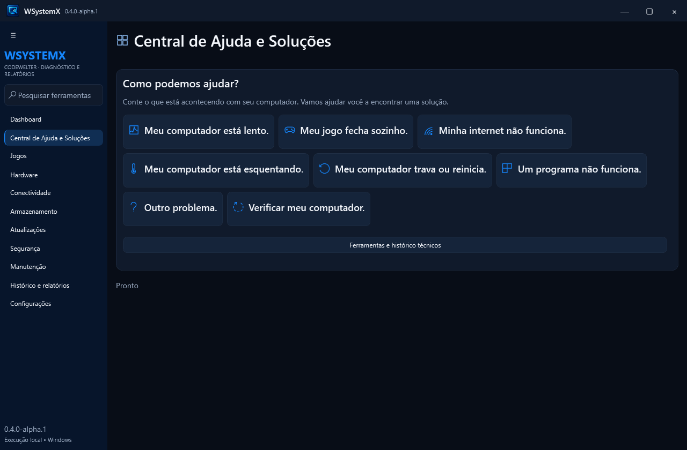

# WSystemX v0.4.0 em desenvolvimento

O primeiro marco da v0.4.0 está em homologação para Windows x64. A versão estável disponível para download continua sendo a v0.3.5.

A Central de Ajuda e Soluções da alfa parte de problemas comuns, como lentidão, falhas de conexão, aquecimento e jogos que fecham. Você pode escolher um problema ou descrevê-lo em português. O WSystemX usa regras locais para sugerir uma investigação, explica o que encontrou e indica o próximo passo. As evidências ficam disponíveis no modo técnico.

Quando as verificações indicam dificuldade para localizar sites, a Central pode oferecer a limpeza dos endereços guardados temporariamente pelo Windows. A ação pede confirmação e, em seguida, repete a verificação da conexão. O histórico de diagnóstico é local.

O Laboratório de Estabilidade continua disponível na Central. Ele reúne verificações leves de memória, integração com o serviço opcional de monitoramento e exportação em JSON. Os testes curtos de CPU e RAM pedem confirmação a cada execução e podem ser cancelados.

A homologação ainda cobre instalação e atualização do serviço no Windows, integração com a Central e limites de execução em hardware real. Os testes de carga de GPU e armazenamento seguem em desenvolvimento.

A [página de versões](https://github.com/FelipeWelter/WSystemX-Releases/releases) reúne os instaladores disponíveis.
